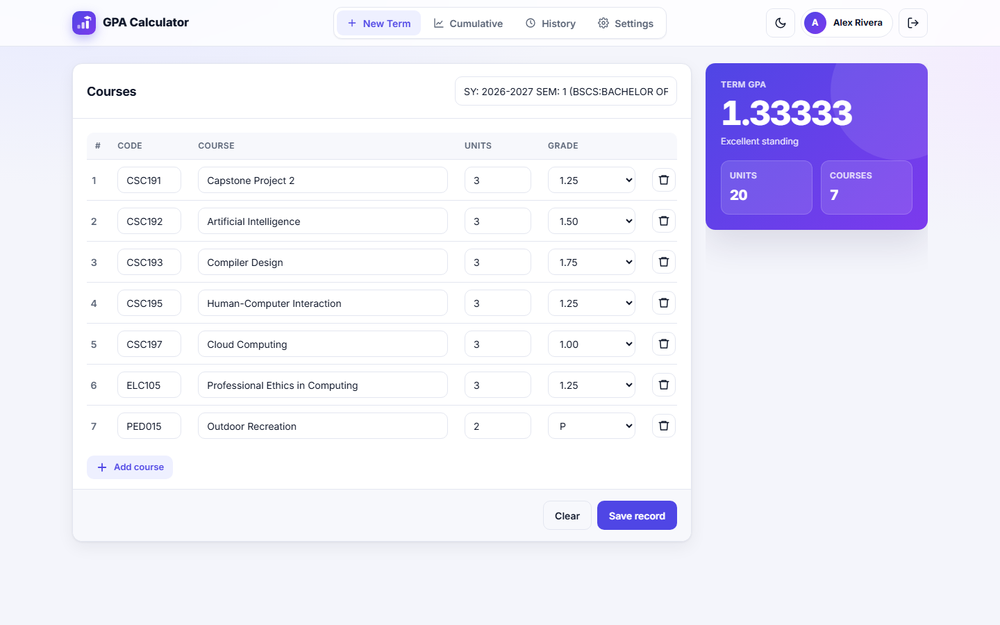
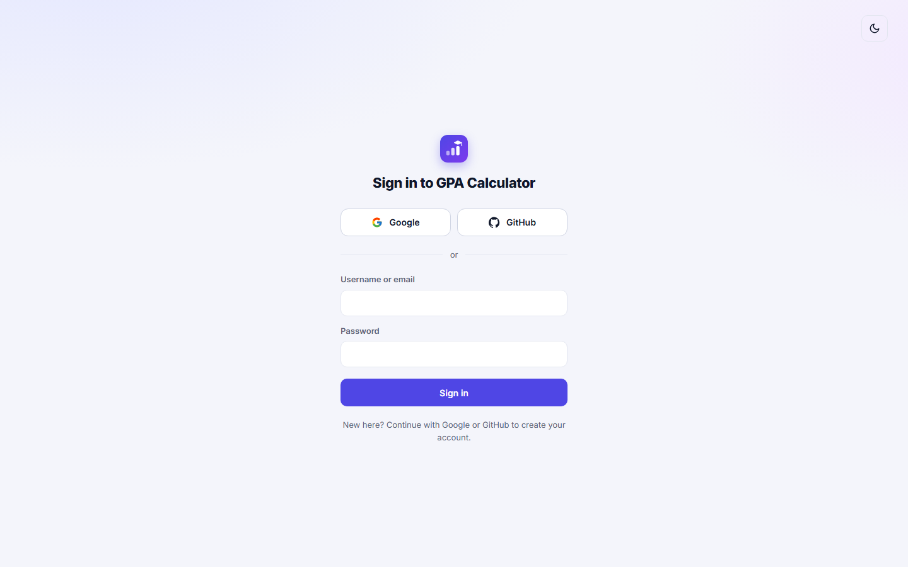
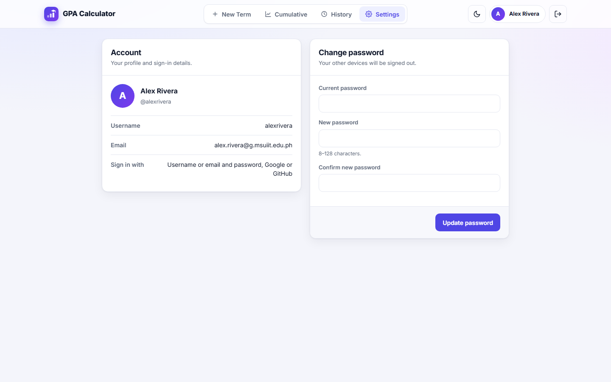
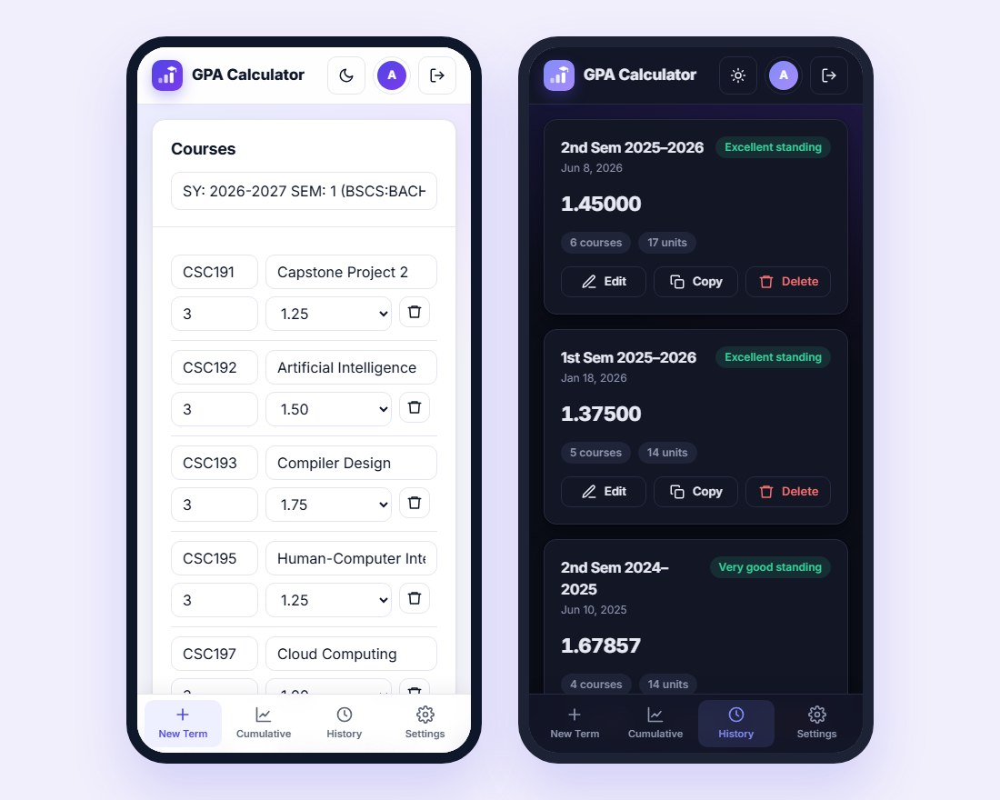

<div align="center" id="top">


# GPA Calculator

**Compute, save and track your term GPA and cumulative GPA, on the MSU-IIT grading scale.**




</div>

---

## Table of Contents

- [Features](#features)
- [Tech Stack](#tech-stack)
- [Prerequisites](#prerequisites)
- [Installation](#installation)
- [Configuration](#configuration)
- [Usage](#usage)
- [Project Structure](#project-structure)
- [Scripts](#scripts)
- [Testing](#testing)
- [Troubleshooting](#troubleshooting)
- [Contributing](#contributing)
- [License](#license)
- [Author](#author)

---

## Features

- **Google and GitHub sign-in for everyone.** School accounts (for example `@g.msuiit.edu.ph`), personal Google accounts and GitHub accounts can all sign in. Signing in with a different provider that has the same verified email opens the same account. Set `ALLOW_EXTERNAL_EMAILS=false` to allow school accounts only.
- **Username and password sign-in.** New accounts are created through Google or GitHub. On the first sign-in the app asks for a username and password. After that you can sign in with your username (or email) and password, or keep using Google or GitHub.
- **Settings.** See your name, username and email, and change your password. Changing it signs out every other device.
- **Live term GPA.** GPA, total units and course count update as you type.
- **Paste from MyIIT.** Copy a semester's grades from MyIIT and paste them into any New Term field: the `SY: … SEM: …` line becomes the term name and each line becomes a course with its code, title and grade. MyIIT doesn't show units, so the units fields are highlighted for you to fill in.
- **Course codes.** An optional Code column (e.g. `CCC100`) is saved with each course.
- **Cumulative GPA (CGPA).** Combine any saved terms, add extra subjects that aren't part of a term, and save the result as a named CGPA record. One panel with three tabs: **Saved terms** (pick terms, then name and save the CGPA), **Additional subjects** and **Saved CGPA** (your saved records, with a count).
- **History.** Saved terms appear as cards with GPA, an academic standing badge, course count and units. **Edit** a term, **Copy** it into a new one, or **Delete** it (with a confirmation dialog). The grading scale stays open on the left, sticky and full height.
- **Fits the screen on desktop.** The sections (New Term, Cumulative, History, Settings) live in the header. On windows at least 700 px tall each view fits without page scrolling; long lists scroll inside their own panel. Shorter windows scroll normally.
- **Linkable views.** Each section has its own URL (`/dashboard#history`), so back/forward, bookmarks and "open in new tab" work.
- **Phone friendly.** On phones the sections move to a bottom tab bar, the page scrolls normally, and fields use 16 px text so iOS doesn't zoom in.
- **Light and dark themes.** Follows your system theme live until you pick one; picking your system's theme goes back to following it. Native scrollbars and menus match the theme.
- **Accessible.** WCAG 2.2 AA checked with axe-core on every view: skip link, visible focus rings, labelled controls, keyboard-friendly dialogs and tabs, announced errors, and reduced motion when the system asks for it.
- **Installable.** A web app manifest, maskable icons and an Apple touch icon let you add it to your home screen.
- **Fast first paint.** The Inter font is self-hosted and preloaded (no third-party font request).
- **Precise.** GPA values are computed and stored to 5 decimal places.
- **Persistent sessions.** Sessions are stored in MySQL, so you stay signed in after the server restarts.
- **Search-ready sign-in page.** `robots.txt` and `sitemap.xml` are built from `APP_URL`, plus an absolute canonical tag, JSON-LD, Open Graph and Twitter share cards with a preview image, and `llms.txt`.

<details>
<summary><strong>Grading scale</strong></summary>

| Grade | Meaning | Counted in GPA |
| --- | --- | :---: |
| `1.00` | Excellent | ✅ |
| `1.25` – `1.50` | Very good | ✅ |
| `1.75` – `2.00` | Good | ✅ |
| `2.25` – `2.50` | Satisfactory | ✅ |
| `2.75` – `3.00` | Passing | ✅ |
| `5.00` | Failed | ✅ |
| `P` | Passed | ❌ (units credited) |
| `INC` | Incomplete | ❌ |
| `DROP` | Dropped | ❌ |

GPA is the unit-weighted average **Σ(grade × units) / Σ units** over graded courses only. A lower GPA is better. `P` courses are left out of the GPA, but their units count toward the unit totals. `INC` and `DROP` are saved with the term but left out of both.

</details>

<p align="right"><a href="#top">back to top ↑</a></p>

---

## Tech Stack

| Layer | Technology |
| --- | --- |
| Backend | Node.js 20+, Express 4 |
| Database | MySQL 8 or TiDB Cloud (`mysql2`) |
| Auth | Username / password (Node `crypto.scrypt`), Google OAuth 2.0 (`google-auth-library`), GitHub OAuth (built-in `fetch`), `express-session` |
| Sessions | `express-mysql-session` |
| Frontend | Vanilla HTML, CSS and JavaScript, self-hosted Inter variable font (SIL OFL) |
| Testing | Node's built-in test runner (`node:test`), GitHub Actions CI |
| Hosting | Vercel (see [DEPLOY.md](DEPLOY.md)) |

<p align="right"><a href="#top">back to top ↑</a></p>

---

## Prerequisites

- [Node.js](https://nodejs.org/) 20 or newer
- [MySQL](https://dev.mysql.com/downloads/) 8 or newer, or a hosted MySQL-compatible database (TiDB Cloud, Aiven, Railway)
- A Google Cloud project with OAuth credentials
- A GitHub OAuth App

<p align="right"><a href="#top">back to top ↑</a></p>

---

## Installation

### 1. Install dependencies and create `.env`

```bash
npm install
```

```bash
copy .env.example .env
```

Fill in `.env` (see [Configuration](#configuration)).

### 2. Create the database

```bash
npm run db:setup
```

This creates (or upgrades) the tables in the database from `.env`. You can also run `db/schema.sql` yourself in the MySQL client.

### 3. Create Google OAuth credentials

1. Open the [Google Cloud Console](https://console.cloud.google.com/), create a project and go to **APIs & Services → OAuth consent screen**.
2. Choose **External** so personal Google accounts can sign in, then publish the app. The `openid email profile` scopes need no verification.
3. Go to **Credentials → Create credentials → OAuth client ID → Web application**.
4. Add the redirect URI `http://localhost:3000/api/auth/google/callback`, plus your production URL when you deploy.
5. Copy the client ID and secret into `.env`.

### 4. Create a GitHub OAuth App

1. Go to **GitHub → Settings → Developer settings → OAuth Apps → New OAuth App**.
2. Set the homepage URL to `http://localhost:3000` and the callback URL to `http://localhost:3000/api/auth/github/callback`.
3. Register the app and generate a client secret.
4. Copy the client ID and secret into `.env`.

### 5. Run

```bash
npm run dev
```

Open **http://localhost:3000**.

<details>
<summary><strong>Upgrading an existing database</strong></summary>

`npm run db:setup` adds missing columns automatically. To do it by hand:

```sql
-- 5-decimal precision
ALTER TABLE gpa_records MODIFY COLUMN gpa DECIMAL(6,5) NOT NULL;
ALTER TABLE cgpa_records MODIFY COLUMN cgpa DECIMAL(6,5) NOT NULL;
-- Google sign-in
ALTER TABLE users ADD COLUMN google_sub VARCHAR(64) NULL UNIQUE AFTER email;
ALTER TABLE users MODIFY COLUMN password_hash VARCHAR(191) NULL;
-- GitHub sign-in
ALTER TABLE users ADD COLUMN github_id BIGINT UNSIGNED NULL UNIQUE AFTER google_sub;
-- Username and password sign-in
ALTER TABLE users ADD COLUMN username VARCHAR(30) NULL AFTER email;
ALTER TABLE users ADD UNIQUE INDEX username (username);
```

Existing users who sign in with a provider that has the same email are linked automatically and keep their history. Existing OAuth users are asked to choose a username and password on their next sign-in.

</details>

<p align="right"><a href="#top">back to top ↑</a></p>

---

## Configuration

All settings come from `.env` locally, and from **Project Settings → Environment Variables** on Vercel. See [DEPLOY.md](DEPLOY.md) for deploying with an online database and a custom domain.

<details>
<summary><strong>Environment variables</strong></summary>

| Variable | Required | Default | Description |
| --- | :---: | --- | --- |
| `APP_URL` | | `http://localhost:3000` | Public address of the site. OAuth callbacks, `robots.txt` and `sitemap.xml` are built from it, so set it to your real domain in production. |
| `DATABASE_URL` | | | Single MySQL connection URL (hosted databases). Overrides the `DB_*` values. |
| `DB_SSL` | | `false` | `true` for hosted databases that require TLS (TiDB Cloud, Aiven) |
| `DB_SSL_CA` | | | CA certificate (PEM contents or a file path), if your provider gives one |
| `DB_HOST` | | `localhost` | MySQL host |
| `DB_PORT` | | `3306` | MySQL port |
| `DB_USER` | | `root` | MySQL user |
| `DB_PASSWORD` | | *(empty)* | MySQL password |
| `DB_NAME` | | `gpa_app` | Database name |
| `SESSION_SECRET` | ✅ | | Long random string used to sign session cookies |
| `PORT` | | `3000` | HTTP port |
| `GOOGLE_CLIENT_ID` | ✅ | | OAuth client ID |
| `GOOGLE_CLIENT_SECRET` | ✅ | | OAuth client secret |
| `GOOGLE_REDIRECT_URI` | | `<APP_URL>/api/auth/google/callback` | Override for the Google callback URL |
| `GITHUB_CLIENT_ID` | ✅ | | GitHub OAuth App client ID |
| `GITHUB_CLIENT_SECRET` | ✅ | | GitHub OAuth App client secret |
| `GITHUB_REDIRECT_URI` | | `<APP_URL>/api/auth/github/callback` | Override for the GitHub callback URL |
| `ALLOWED_EMAIL_DOMAINS` | | *(empty)* | Comma-separated school domains, e.g. `g.msuiit.edu.ph`. Shown on the login page; enforced when external emails are off. |
| `ALLOW_EXTERNAL_EMAILS` | | `true` | `true`: any verified Google or GitHub account can sign in. `false`: only `ALLOWED_EMAIL_DOMAINS`. |
| `NODE_ENV` | | | `production` enables secure cookies and trusts the first proxy |

If `ALLOWED_EMAIL_DOMAINS` is empty, external accounts are always allowed.

</details>

<p align="right"><a href="#top">back to top ↑</a></p>

---

## Usage

<details open>
<summary><strong>Screenshots</strong></summary>

| Sign in | Settings |
| :---: | :---: |
|  |  |

| Cumulative GPA | History |
| :---: | :---: |
|  |  |

| Dark mode | Phone (bottom tab bar) |
| :---: | :---: |
|  |  |

</details>

### New student

1. Open the site and choose **Google** or **GitHub**.
2. On first sign-in, pick a username and password on the setup page.
3. You land on **New Term**: type a term name, add courses with units and grades, and watch the GPA card update. Click **Save record**.

### Pasting grades from MyIIT

1. In MyIIT, select a semester's block (the `SY:` line and its course lines) and copy it, for example:
   ```text
   SY: 2023-2024 SEM: 1 (BSIT:BACHELOR OF SCIENCE IN INFORMATION TECHNOLOGY)
   CCC100	Fundamentals of Computing	1.00
   CCC101	Computer Programming 1	1.25
   ```
2. Click any field on **New Term** and paste (Ctrl+V / Cmd+V). The term name and every course fill in; the rows replace whatever was there.
3. Fill in the highlighted **Units** fields, then click **Save record**.

Pasting a single course line into a row fills just that row. If you copy several semesters at once, only the first is used. Ordinary text pastes normally.

### Returning student

1. Sign in with your username (or email) and password, or Google/GitHub.
2. Use the header tabs (bottom bar on phones):
   - **New Term**: enter a new term, or paste your grades from MyIIT.
   - **Cumulative**: tick the saved terms to include, switch to **Additional subjects** to add extra subjects, then name and save the CGPA at the bottom of the **Saved terms** tab. Open **Saved CGPA** to see or delete saved records.
   - **History**: check the **Grading scale** on the left. **Edit** a term to update it, **Copy** it to start a new term from it, or **Delete** it.
   - **Settings** (or click your avatar): check your username and email, and change your password.

### Changing your password

In **Settings → Change password**, enter your current password and the new one twice (8–128 characters), then **Update password**. You stay signed in on this device; other devices are signed out.

```http
POST /api/auth/password
Content-Type: application/json

{ "currentPassword": "old-password", "newPassword": "new-password" }
```

<details>
<summary><strong>API reference</strong></summary>

Every `/api/gpa/*` endpoint requires a signed-in session. After a first OAuth sign-in the session is *pending* (redirected to `/setup`) until a username and password are chosen.

| Method | Endpoint | Description |
| --- | --- | --- |
| `GET` | `/api/auth/google` | Start Google sign-in |
| `GET` | `/api/auth/google/callback` | Google OAuth callback |
| `GET` | `/api/auth/github` | Start GitHub sign-in |
| `GET` | `/api/auth/github/callback` | GitHub OAuth callback |
| `POST` | `/api/auth/login` | Sign in `{ identifier, password }` (username or email) |
| `GET` | `/api/auth/setup` | Name and email of the account waiting for setup |
| `POST` | `/api/auth/setup` | Finish setup `{ username, password }` |
| `POST` | `/api/auth/password` | Change password `{ currentPassword, newPassword }`; signs out other sessions |
| `GET` | `/api/auth/config` | Sign-in policy (`allowedDomains`, `allowExternal`) |
| `GET` | `/api/auth/status` | `{ signedIn, pendingSetup }`, always `200` (used by public pages) |
| `GET` | `/api/auth/me` | Current user (`id`, `name`, `email`, `username`) |
| `POST` | `/api/auth/logout` | Sign out |
| `GET` | `/api/gpa/history` | List saved terms |
| `POST` | `/api/gpa/save` | Save a term `{ termName, courses[] }` |
| `PUT` | `/api/gpa/:id` | Update a term |
| `DELETE` | `/api/gpa/:id` | Delete a term |
| `POST` | `/api/gpa/calculate-cumulative` | Compute CGPA `{ termIds[], additionalSubjects[] }` |
| `GET` | `/api/gpa/cgpa` | List saved CGPA records |
| `POST` | `/api/gpa/save-cgpa` | Save a CGPA record (recomputed on the server) |
| `DELETE` | `/api/gpa/cgpa/:id` | Delete a CGPA record |
| `GET` | `/api/health` | Health check, including the database (result cached for 30 seconds) |
| `GET` | `/robots.txt`, `/sitemap.xml` | Built from `APP_URL` |

Every `/api/*` response is sent with `Cache-Control: no-store`. Pages use clean URLs: `/login`, `/setup`, `/dashboard`. Old `.html` links get a `301` to the clean URL. Unknown `/api/*` routes return `404` JSON; other unknown URLs show `public/404.html`.

</details>

### Importing terms from an old database dump

`scripts/import-terms.js` copies one user's terms from an old `mysqldump` of `gpa_records` into an existing account. GPAs are recomputed and already-imported terms are skipped. Preview with `--dry-run`:

```bash
npm run db:import -- path/to/gpa_app_gpa_records.sql --from-user 3 --to-email you@g.msuiit.edu.ph --dry-run
```

<p align="right"><a href="#top">back to top ↑</a></p>

---

## Project Structure

```
gpa-calculator/
├── .github/workflows/
│   └── ci.yml             # Runs the tests and npm audit on Node 20 and 22
├── db/
│   ├── db.js              # MySQL connection pool
│   └── schema.sql         # Database schema
├── docs/screenshots/      # README images
├── lib/
│   ├── app-url.js         # Public site address (APP_URL) shared by OAuth, robots.txt and sitemap.xml
│   ├── password.js        # scrypt password hashing
│   └── rate-limit.js      # Failed-attempt counter stored in MySQL (memory fallback)
├── middleware/
│   └── auth.js            # Session guard for protected routes
├── public/
│   ├── login.html         # Sign-in page (the only indexed page)
│   ├── login.js           # Sign-in form and OAuth error messages
│   ├── setup.html         # Choose a username and password after the first OAuth sign-in
│   ├── setup.js           # Setup form logic
│   ├── 404.html           # Not-found page
│   ├── dashboard.html     # Main app: header tabs, New Term, Cumulative, History, Settings
│   ├── dashboard.js       # Dashboard logic
│   ├── myiit-paste.js     # Parses grades copied from MyIIT (also used by the tests)
│   ├── darkmode.js        # Theme handling (follows the system until you choose)
│   ├── fonts/             # Self-hosted Inter variable font and its OFL license
│   ├── icons/             # App icons (192, 512, maskable, Apple touch icon)
│   ├── favicon.ico        # Legacy favicon for crawlers and old browsers
│   ├── logo.svg           # Vector logo and modern favicon
│   ├── manifest.webmanifest # Install-to-home-screen metadata
│   ├── og-image.png       # 1200×630 social share image
│   ├── llms.txt           # Plain-language summary for AI crawlers
│   └── style.css          # Design system, no-scroll desktop layout, mobile bottom bar
├── routes/
│   ├── auth.js            # OAuth, password sign-in, setup, change password, session routes
│   └── gpa.js             # GPA and CGPA routes
├── scripts/
│   ├── setup-db.js        # Creates/upgrades the tables (npm run db:setup)
│   └── import-terms.js    # Copies terms from an old mysqldump (npm run db:import)
├── test/                  # Automated tests (npm test), no database needed
├── server.js              # Express app, security headers, robots.txt and sitemap.xml
├── LICENSE                # Sprucetrap Source-Available License 1.0
├── vercel.json            # Clean URLs and security headers on Vercel
└── .env.example           # Environment template
```

<p align="right"><a href="#top">back to top ↑</a></p>

---

## Scripts

| Script | Description |
| --- | --- |
| `npm start` | Start the server |
| `npm run dev` | Start with auto-reload (Node's built-in `--watch`) and `.env` |
| `npm test` | Run the automated tests |
| `npm run db:setup` | Create or upgrade the tables in the configured database |
| `npm run db:import` | Import terms from an old `mysqldump` (see [Usage](#usage)) |

<p align="right"><a href="#top">back to top ↑</a></p>

---

## Testing

### Automated tests

```bash
npm test
```

The tests use Node's built-in test runner and need **no database** (they point at an address that refuses connections and keep sessions in memory). GitHub Actions runs them, plus `npm audit`, on every push and pull request to `main`.

| File | Covers |
| --- | --- |
| `test/gpa.test.js` | Weighted GPA, `P` / `INC` / `DROP` rules, input validation limits, optional course code |
| `test/myiit-paste.test.js` | Parsing MyIIT copies: term name, courses, grade normalising, spaced copies, ignoring ordinary text |
| `test/password.test.js` | scrypt hashing, salts, verification, rejecting non-scrypt values |
| `test/rate-limit.test.js` | Failure counting, windows, clearing, memory fallback |
| `test/api.test.js` | 401 on private routes, `no-store`, security headers, cross-origin block, bad JSON / too-large bodies, OAuth `state` and short session, robots/sitemap, redirects, 404s, static assets |

### Manual checks

Run these with `npm run dev`:

1. **Sign-in:** Google, GitHub, and username/password all reach the dashboard; a wrong password shows one generic error; an empty submit focuses the empty field.
2. **Desktop layout (1440×900):** every tab fits the window with no page scrollbar; add 15+ courses and the course list scrolls inside its panel.
3. **New Term:** the GPA updates while typing; **Save record** adds a History card. Pasting a MyIIT copy fills the term name and courses and highlights the units.
4. **Cumulative:** ticking terms updates the totals; extra subjects are included; the name-and-save row shows only on **Saved terms**; a named CGPA saves, appears under **Saved CGPA** and can be deleted.
5. **History:** the grading scale fills the height on the left; **Edit**, **Copy** and **Delete** work; Delete asks first and Escape cancels.
6. **Navigation:** switching sections changes the URL; browser back/forward moves between sections.
7. **Settings:** your username and email show; a wrong current password, a mismatched confirmation and a short password are rejected; a valid change shows a success toast, the new password signs in, and another browser's session is signed out.
8. **Phone (375 px):** the bottom tab bar reaches every section, nothing hides behind it, no horizontal scroll.
9. **Themes:** light and dark both look right, including scrollbars and dropdowns.
10. **Keyboard:** Tab from the top shows "Skip to content"; every control has a visible focus ring.
11. **SEO files:** `/robots.txt`, `/sitemap.xml` and `/llms.txt` load and use your `APP_URL`.

<p align="right"><a href="#top">back to top ↑</a></p>

---

## Troubleshooting

| Problem | Fix |
| --- | --- |
| `Missing required environment variables` on start | Fill in `SESSION_SECRET` and the Google/GitHub client IDs and secrets in `.env`. |
| OAuth redirects to `/login?error=oauth` | The callback URL in Google/GitHub must match `APP_URL` exactly. |
| `/login?error=domain` | `ALLOW_EXTERNAL_EMAILS=false` and the account is not in `ALLOWED_EMAIL_DOMAINS`. |
| Database connection errors | Check `DATABASE_URL` or `DB_*`; hosted databases need `DB_SSL=true`. `GET /api/health` shows whether the database is reachable. |
| "Too many failed attempts" | Wait 15 minutes; the limit is per account guess and per IP. To clear it early, delete the rows in the `auth_attempts` table. |
| Sitemap shows `localhost` | Set `APP_URL` to your public domain in production. |

<p align="right"><a href="#top">back to top ↑</a></p>

---

## Contributing

1. Branch from `main` with a matching prefix: `feat/short-description`, `fix/short-description`, `docs/…`, `chore/…`.
2. Use [Conventional Commits](https://www.conventionalcommits.org/): `feat:`, `fix:`, `docs:`, `refactor:`, `chore:`, `style:`, `perf:`, `test:`; an imperative subject of 72 characters or less, a blank line, then one bullet per change.
3. **Bump the version in every commit** and end the subject with it, e.g. `feat: add CSV export (v1.4.0)`. Breaking change → major, `feat` → minor, anything else → patch. Update `package.json`, `package-lock.json` and the version badge at the top of this README in the same commit.
4. Run `npm test`, the [manual checks](#testing) and `npm audit`.
5. **Update this README with every change** (features, configuration, structure, version badges when dependencies change).
6. Never commit `.env` or downloaded `client_secret_*.json` files.

<details>
<summary><strong>Security notes</strong></summary>

- Only OAuth accounts with a **verified email** can sign in; the school domain is checked on the server when external emails are off.
- GitHub sign-in uses only the account's primary verified email; the GitHub token is used once and never stored.
- Passwords are hashed with **scrypt** and a per-user salt, compared in constant time. Sign-in and password changes are rate-limited: 10 failures per account guess and 50 per IP address every 15 minutes. Counts are stored in MySQL (`auth_attempts`, keys hashed), so every Vercel instance shares them.
- Visitors who start an OAuth sign-in get a 10-minute session, and an unfinished account setup lasts 30 minutes, so abandoned attempts expire quickly.
- Changing a password removes every other session of that account and rotates the current session ID.
- OAuth `state` protects against CSRF; the session ID is regenerated after sign-in.
- Session cookies are `httpOnly`, `sameSite=lax` and `secure` in production.
- User text is HTML-escaped; a strict CSP (`'self'` only, no inline scripts, no third-party hosts), `nosniff`, `X-Frame-Options`, `Cross-Origin-Opener-Policy`, HSTS and Referrer-Policy are sent by Express and `vercel.json`.
- API responses are `Cache-Control: no-store`, so per-user data is never stored by browsers or the CDN.
- Cross-origin state-changing requests are rejected; bodies are capped at 100 KB; inputs are validated on the server; every GPA query is scoped to the signed-in user.
- Only `public/` is served statically; `.env`, sources and `node_modules` return `404`.

</details>

<details>
<summary><strong>Backlink ideas (do these yourself)</strong></summary>

- Share the site in MSU-IIT student groups, org pages and college Discord/Messenger communities.
- Add it to your GitHub profile README and portfolio site.
- Write a short post (Dev.to, Medium, Facebook) on how the MSU-IIT GPA is computed, linking to the app.
- Ask student councils or orgs to list it on their resources page.
- Submit it to student-tool directories once it has a custom domain.

</details>

<p align="right"><a href="#top">back to top ↑</a></p>

---

## License

Released under the **Sprucetrap Source-Available License 1.0**. See [LICENSE](LICENSE).

- ✅ View, run, study and modify the code for personal, educational or other non-commercial use, and share non-commercial forks.
- 📝 Keep the copyright notice, credit **Sprucetrap** with a link to [github.com/Jevoel16](https://github.com/Jevoel16), and say what you changed.
- ❌ No commercial use, resale, sublicensing or rebranding without written permission. Ask through [GitHub](https://github.com/Jevoel16).

---

## Author

**Sprucetrap** ([github.com/Jevoel16](https://github.com/Jevoel16)), built for MSU-IIT students.

<p align="right"><a href="#top">back to top ↑</a></p>
