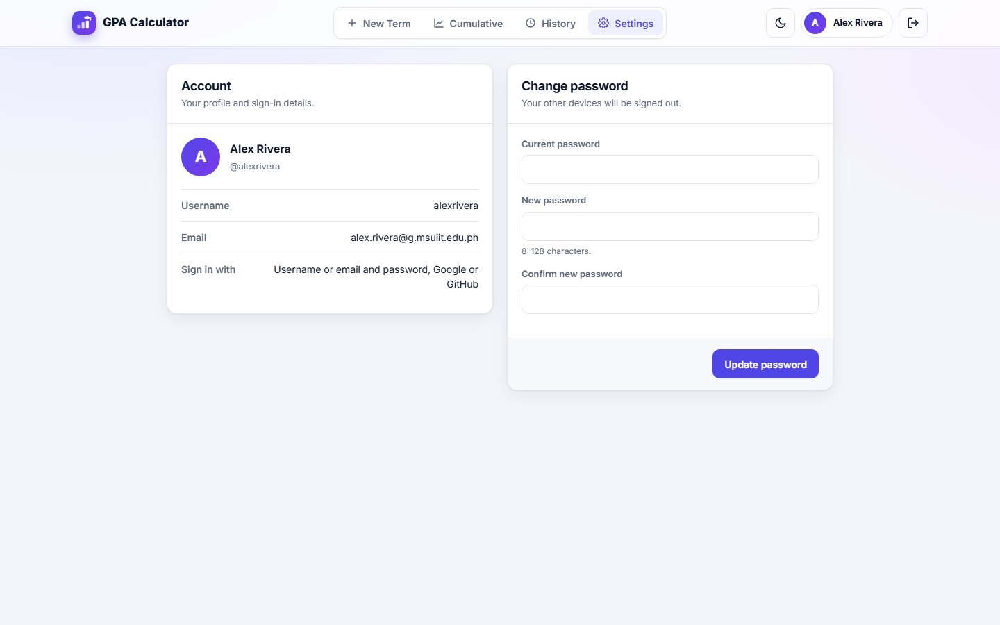

<div align="center" id="top">


# GPA Calculator

**Compute, save and track your term GPA and cumulative GPA, on the MSU-IIT grading scale.**


</div>

---

## Table of Contents

- [Features](#features)
- [Tech Stack](#tech-stack)
- [Prerequisites](#prerequisites)
- [Installation](#installation)
- [Configuration](#configuration)
- [Usage](#usage)
- [Project Structure](#project-structure)
- [Scripts](#scripts)
- [Testing](#testing)
- [Troubleshooting](#troubleshooting)
- [Contributing](#contributing)
- [License](#license)
- [Author](#author)

---

## Features

- **Google and GitHub sign-in for everyone.** School accounts (for example `@g.msuiit.edu.ph`), personal Google accounts and GitHub accounts can all sign in. Signing in with a different provider that has the same verified email opens the same account. Set `ALLOW_EXTERNAL_EMAILS=false` to allow school accounts only.
- **Username and password sign-in.** New accounts are created through Google or GitHub. On the first sign-in the app asks for a username and password. After that you can sign in with your username (or email) and password, or keep using Google or GitHub.
- **Settings.** See your name, username and email, and change your password. Changing it signs out every other device.
- **Live term GPA.** GPA, total units and course count update as you type.
- **Cumulative GPA (CGPA).** Combine any saved terms, add extra subjects that aren't part of a term, and save the result as a named CGPA record.
- **History.** Saved terms appear as cards with GPA, an academic standing badge, course count and units. Open, edit or delete any of them.
- **Fits the screen on desktop.** The sections (New Term, Cumulative, History, Settings) live in the header. Each view fits the window without page scrolling; long lists scroll inside their own panel.
- **Phone friendly.** On phones the sections move to a bottom tab bar, and the page scrolls normally.
- **Light and dark themes.** Follows your system theme by default and remembers your choice.
- **Precise.** GPA values are computed and stored to 5 decimal places.
- **Persistent sessions.** Sessions are stored in MySQL, so you stay signed in after the server restarts.
- **Search-ready sign-in page.** `robots.txt` and `sitemap.xml` are built from `APP_URL`, plus a canonical tag, JSON-LD and `llms.txt`.

<details>
<summary><strong>Grading scale</strong></summary>

| Grade | Meaning | Counted in GPA |
| --- | --- | :---: |
| `1.00` | Excellent | ✅ |
| `1.25` – `1.50` | Very good | ✅ |
| `1.75` – `2.00` | Good | ✅ |
| `2.25` – `2.50` | Satisfactory | ✅ |
| `2.75` – `3.00` | Passing | ✅ |
| `5.00` | Failed | ✅ |
| `P` | Passed | ❌ (units credited) |
| `INC` | Incomplete | ❌ |
| `DROP` | Dropped | ❌ |

GPA is the unit-weighted average **Σ(grade × units) / Σ units** over graded courses only. A lower GPA is better. `P` courses are left out of the GPA, but their units count toward the unit totals. `INC` and `DROP` are saved with the term but left out of both.

</details>

<p align="right"><a href="#top">back to top ↑</a></p>

---

## Tech Stack

| Layer | Technology |
| --- | --- |
| Backend | Node.js 20+, Express 4 |
| Database | MySQL 8 or TiDB Cloud (`mysql2`) |
| Auth | Username / password (Node `crypto.scrypt`), Google OAuth 2.0 (`google-auth-library`), GitHub OAuth (built-in `fetch`), `express-session` |
| Sessions | `express-mysql-session` |
| Frontend | Vanilla HTML, CSS and JavaScript, Inter font |
| Hosting | Vercel (see [DEPLOY.md](DEPLOY.md)) |

<p align="right"><a href="#top">back to top ↑</a></p>

---

## Prerequisites

- [Node.js](https://nodejs.org/) 20 or newer
- [MySQL](https://dev.mysql.com/downloads/) 8 or newer, or a hosted MySQL-compatible database (TiDB Cloud, Aiven, Railway)
- A Google Cloud project with OAuth credentials
- A GitHub OAuth App

<p align="right"><a href="#top">back to top ↑</a></p>

---

## Installation

### 1. Install dependencies and create `.env`

```bash
npm install
```

```bash
copy .env.example .env
```

Fill in `.env` (see [Configuration](#configuration)).

### 2. Create the database

```bash
npm run db:setup
```

This creates (or upgrades) the tables in the database from `.env`. You can also run `db/schema.sql` yourself in the MySQL client.

### 3. Create Google OAuth credentials

1. Open the [Google Cloud Console](https://console.cloud.google.com/), create a project and go to **APIs & Services → OAuth consent screen**.
2. Choose **External** so personal Google accounts can sign in, then publish the app. The `openid email profile` scopes need no verification.
3. Go to **Credentials → Create credentials → OAuth client ID → Web application**.
4. Add the redirect URI `http://localhost:3000/api/auth/google/callback`, plus your production URL when you deploy.
5. Copy the client ID and secret into `.env`.

### 4. Create a GitHub OAuth App

1. Go to **GitHub → Settings → Developer settings → OAuth Apps → New OAuth App**.
2. Set the homepage URL to `http://localhost:3000` and the callback URL to `http://localhost:3000/api/auth/github/callback`.
3. Register the app and generate a client secret.
4. Copy the client ID and secret into `.env`.

### 5. Run

```bash
npm run dev
```

Open **http://localhost:3000**.

<details>
<summary><strong>Upgrading an existing database</strong></summary>

`npm run db:setup` adds missing columns automatically. To do it by hand:

```sql
-- 5-decimal precision
ALTER TABLE gpa_records MODIFY COLUMN gpa DECIMAL(6,5) NOT NULL;
ALTER TABLE cgpa_records MODIFY COLUMN cgpa DECIMAL(6,5) NOT NULL;
-- Google sign-in
ALTER TABLE users ADD COLUMN google_sub VARCHAR(64) NULL UNIQUE AFTER email;
ALTER TABLE users MODIFY COLUMN password_hash VARCHAR(191) NULL;
-- GitHub sign-in
ALTER TABLE users ADD COLUMN github_id BIGINT UNSIGNED NULL UNIQUE AFTER google_sub;
-- Username and password sign-in
ALTER TABLE users ADD COLUMN username VARCHAR(30) NULL AFTER email;
ALTER TABLE users ADD UNIQUE INDEX username (username);
```

Existing users who sign in with a provider that has the same email are linked automatically and keep their history. Existing OAuth users are asked to choose a username and password on their next sign-in.

</details>

<p align="right"><a href="#top">back to top ↑</a></p>

---

## Configuration

All settings come from `.env` locally, and from **Project Settings → Environment Variables** on Vercel. See [DEPLOY.md](DEPLOY.md) for deploying with an online database and a custom domain.

<details>
<summary><strong>Environment variables</strong></summary>

| Variable | Required | Default | Description |
| --- | :---: | --- | --- |
| `APP_URL` | | `http://localhost:3000` | Public address of the site. OAuth callbacks, `robots.txt` and `sitemap.xml` are built from it, so set it to your real domain in production. |
| `DATABASE_URL` | | | Single MySQL connection URL (hosted databases). Overrides the `DB_*` values. |
| `DB_SSL` | | `false` | `true` for hosted databases that require TLS (TiDB Cloud, Aiven) |
| `DB_SSL_CA` | | | CA certificate (PEM contents or a file path), if your provider gives one |
| `DB_HOST` | | `localhost` | MySQL host |
| `DB_PORT` | | `3306` | MySQL port |
| `DB_USER` | | `root` | MySQL user |
| `DB_PASSWORD` | | *(empty)* | MySQL password |
| `DB_NAME` | | `gpa_app` | Database name |
| `SESSION_SECRET` | ✅ | | Long random string used to sign session cookies |
| `PORT` | | `3000` | HTTP port |
| `GOOGLE_CLIENT_ID` | ✅ | | OAuth client ID |
| `GOOGLE_CLIENT_SECRET` | ✅ | | OAuth client secret |
| `GOOGLE_REDIRECT_URI` | | `<APP_URL>/api/auth/google/callback` | Override for the Google callback URL |
| `GITHUB_CLIENT_ID` | ✅ | | GitHub OAuth App client ID |
| `GITHUB_CLIENT_SECRET` | ✅ | | GitHub OAuth App client secret |
| `GITHUB_REDIRECT_URI` | | `<APP_URL>/api/auth/github/callback` | Override for the GitHub callback URL |
| `ALLOWED_EMAIL_DOMAINS` | | *(empty)* | Comma-separated school domains, e.g. `g.msuiit.edu.ph`. Shown on the login page; enforced when external emails are off. |
| `ALLOW_EXTERNAL_EMAILS` | | `true` | `true`: any verified Google or GitHub account can sign in. `false`: only `ALLOWED_EMAIL_DOMAINS`. |
| `NODE_ENV` | | | `production` enables secure cookies and trusts the first proxy |

If `ALLOWED_EMAIL_DOMAINS` is empty, external accounts are always allowed.

</details>

<p align="right"><a href="#top">back to top ↑</a></p>

---

## Usage

<details open>
<summary><strong>Screenshots</strong></summary>

| Sign in | Settings |
| :---: | :---: |
|  |  |

| Cumulative GPA | History |
| :---: | :---: |
|  |  |

| Dark mode | Phone (bottom tab bar) |
| :---: | :---: |
|  |  |

</details>

### New student

1. Open the site and choose **Google** or **GitHub**.
2. On first sign-in, pick a username and password on the setup page.
3. You land on **New Term**: type a term name, add courses with units and grades, and watch the GPA card update. Click **Save record**.

### Returning student

1. Sign in with your username (or email) and password, or Google/GitHub.
2. Use the header tabs (bottom bar on phones):
   - **New Term**: enter a new term. Open the **Grading scale** panel for the grade meanings.
   - **Cumulative**: tick the saved terms to include, switch to **Additional subjects** to add extra subjects, then name and save the CGPA from the Breakdown panel.
   - **History**: click a card to load a copy, **Edit** to update it, or **Delete** it.
   - **Settings** (or click your avatar): check your username and email, and change your password.

### Changing your password

In **Settings → Change password**, enter your current password and the new one twice (8–128 characters), then **Update password**. You stay signed in on this device; other devices are signed out.

```http
POST /api/auth/password
Content-Type: application/json

{ "currentPassword": "old-password", "newPassword": "new-password" }
```

<details>
<summary><strong>API reference</strong></summary>

Every `/api/gpa/*` endpoint requires a signed-in session. After a first OAuth sign-in the session is *pending* (redirected to `/setup`) until a username and password are chosen.

| Method | Endpoint | Description |
| --- | --- | --- |
| `GET` | `/api/auth/google` | Start Google sign-in |
| `GET` | `/api/auth/google/callback` | Google OAuth callback |
| `GET` | `/api/auth/github` | Start GitHub sign-in |
| `GET` | `/api/auth/github/callback` | GitHub OAuth callback |
| `POST` | `/api/auth/login` | Sign in `{ identifier, password }` (username or email) |
| `GET` | `/api/auth/setup` | Name and email of the account waiting for setup |
| `POST` | `/api/auth/setup` | Finish setup `{ username, password }` |
| `POST` | `/api/auth/password` | Change password `{ currentPassword, newPassword }`; signs out other sessions |
| `GET` | `/api/auth/config` | Sign-in policy (`allowedDomains`, `allowExternal`) |
| `GET` | `/api/auth/me` | Current user (`id`, `name`, `email`, `username`) |
| `POST` | `/api/auth/logout` | Sign out |
| `GET` | `/api/gpa/history` | List saved terms |
| `POST` | `/api/gpa/save` | Save a term `{ termName, courses[] }` |
| `PUT` | `/api/gpa/:id` | Update a term |
| `DELETE` | `/api/gpa/:id` | Delete a term |
| `POST` | `/api/gpa/calculate-cumulative` | Compute CGPA `{ termIds[], additionalSubjects[] }` |
| `GET` | `/api/gpa/cgpa` | List saved CGPA records |
| `POST` | `/api/gpa/save-cgpa` | Save a CGPA record (recomputed on the server) |
| `DELETE` | `/api/gpa/cgpa/:id` | Delete a CGPA record |
| `GET` | `/api/health` | Health check, including the database |
| `GET` | `/robots.txt`, `/sitemap.xml` | Built from `APP_URL` |

Pages use clean URLs: `/login`, `/setup`, `/dashboard`. Old `.html` links get a `301` to the clean URL. Unknown `/api/*` routes return `404` JSON; other unknown URLs show `public/404.html`.

</details>

### Importing terms from an old database dump

`scripts/import-terms.js` copies one user's terms from an old `mysqldump` of `gpa_records` into an existing account. GPAs are recomputed and already-imported terms are skipped. Preview with `--dry-run`:

```bash
npm run db:import -- path/to/gpa_app_gpa_records.sql --from-user 3 --to-email you@g.msuiit.edu.ph --dry-run
```

<p align="right"><a href="#top">back to top ↑</a></p>

---

## Project Structure

```
gpa-calculator/
├── db/
│   ├── db.js              # MySQL connection pool
│   └── schema.sql         # Database schema
├── docs/screenshots/      # README images
├── lib/
│   ├── app-url.js         # Public site address (APP_URL) shared by OAuth, robots.txt and sitemap.xml
│   └── password.js        # scrypt password hashing
├── middleware/
│   └── auth.js            # Session guard for protected routes
├── public/
│   ├── login.html         # Sign-in page (the only indexed page)
│   ├── login.js           # Sign-in form and OAuth error messages
│   ├── setup.html         # Choose a username and password after the first OAuth sign-in
│   ├── setup.js           # Setup form logic
│   ├── 404.html           # Not-found page
│   ├── dashboard.html     # Main app: header tabs, New Term, Cumulative, History, Settings
│   ├── dashboard.js       # Dashboard logic
│   ├── darkmode.js        # Theme handling
│   ├── llms.txt           # Plain-language summary for AI crawlers
│   └── style.css          # Design system, no-scroll desktop layout, mobile bottom bar
├── routes/
│   ├── auth.js            # OAuth, password sign-in, setup, change password, session routes
│   └── gpa.js             # GPA and CGPA routes
├── scripts/
│   ├── setup-db.js        # Creates/upgrades the tables (npm run db:setup)
│   └── import-terms.js    # Copies terms from an old mysqldump (npm run db:import)
├── server.js              # Express app, security headers, robots.txt and sitemap.xml
├── LICENSE                # Sprucetrap Source-Available License 1.0
├── vercel.json            # Clean URLs and security headers on Vercel
└── .env.example           # Environment template
```

<p align="right"><a href="#top">back to top ↑</a></p>

---

## Scripts

| Script | Description |
| --- | --- |
| `npm start` | Start the server |
| `npm run dev` | Start with auto-reload (nodemon) and `.env` |
| `npm run db:setup` | Create or upgrade the tables in the configured database |
| `npm run db:import` | Import terms from an old `mysqldump` (see [Usage](#usage)) |

<p align="right"><a href="#top">back to top ↑</a></p>

---

## Testing

There are no automated tests yet. Run these manual checks with `npm run dev`:

1. **Sign-in:** Google, GitHub, and username/password all reach the dashboard; a wrong password shows one generic error.
2. **Desktop layout (1440×900):** every tab fits the window with no page scrollbar; add 15+ courses and the course list scrolls inside its panel.
3. **New Term:** the GPA updates while typing; **Save record** adds a History card.
4. **Cumulative:** ticking terms updates the totals; extra subjects are included; a named CGPA saves and can be deleted.
5. **History:** open, edit and delete work.
6. **Settings:** your username and email show; a wrong current password, a mismatched confirmation and a short password are rejected; a valid change shows a success toast, the new password signs in, and another browser's session is signed out.
7. **Phone (375 px):** the bottom tab bar reaches every section, nothing hides behind it, no horizontal scroll.
8. **Themes:** light and dark both look right.
9. **SEO files:** `/robots.txt`, `/sitemap.xml` and `/llms.txt` load and use your `APP_URL`.
10. **Dependencies:** `npm audit` reports 0 vulnerabilities.

<p align="right"><a href="#top">back to top ↑</a></p>

---

## Troubleshooting

| Problem | Fix |
| --- | --- |
| `Missing required environment variables` on start | Fill in `SESSION_SECRET` and the Google/GitHub client IDs and secrets in `.env`. |
| OAuth redirects to `/login?error=oauth` | The callback URL in Google/GitHub must match `APP_URL` exactly. |
| `/login?error=domain` | `ALLOW_EXTERNAL_EMAILS=false` and the account is not in `ALLOWED_EMAIL_DOMAINS`. |
| Database connection errors | Check `DATABASE_URL` or `DB_*`; hosted databases need `DB_SSL=true`. `GET /api/health` shows whether the database is reachable. |
| "Too many failed attempts" | Wait 15 minutes; the limit is per IP and account. |
| Sitemap shows `localhost` | Set `APP_URL` to your public domain in production. |

<p align="right"><a href="#top">back to top ↑</a></p>

---

## Contributing

1. Branch from `main` with a matching prefix: `feat/short-description`, `fix/short-description`, `docs/…`, `chore/…`.
2. Use [Conventional Commits](https://www.conventionalcommits.org/): `feat:`, `fix:`, `docs:`, `refactor:`, `chore:`, `style:`, `perf:`, `test:`; an imperative subject of 72 characters or less, a blank line, then one bullet per change.
3. Run the [manual checks](#testing) and `npm audit`.
4. **Update this README with every change** (features, configuration, structure, version badges when dependencies change).
5. Never commit `.env` or downloaded `client_secret_*.json` files.

<details>
<summary><strong>Security notes</strong></summary>

- Only OAuth accounts with a **verified email** can sign in; the school domain is checked on the server when external emails are off.
- GitHub sign-in uses only the account's primary verified email; the GitHub token is used once and never stored.
- Passwords are hashed with **scrypt** and a per-user salt, compared in constant time. Sign-in and password changes are rate-limited (10 failures per 15 minutes; in memory, so per instance on Vercel).
- Changing a password removes every other session of that account and rotates the current session ID.
- OAuth `state` protects against CSRF; the session ID is regenerated after sign-in.
- Session cookies are `httpOnly`, `sameSite=lax` and `secure` in production.
- User text is HTML-escaped; a strict CSP (no inline scripts), `nosniff`, `X-Frame-Options`, HSTS and Referrer-Policy are sent by Express and `vercel.json`.
- Cross-origin state-changing requests are rejected; bodies are capped at 100 KB; inputs are validated on the server; every GPA query is scoped to the signed-in user.
- Only `public/` is served statically; `.env`, sources and `node_modules` return `404`.

</details>

<details>
<summary><strong>Backlink ideas (do these yourself)</strong></summary>

- Share the site in MSU-IIT student groups, org pages and college Discord/Messenger communities.
- Add it to your GitHub profile README and portfolio site.
- Write a short post (Dev.to, Medium, Facebook) on how the MSU-IIT GPA is computed, linking to the app.
- Ask student councils or orgs to list it on their resources page.
- Submit it to student-tool directories once it has a custom domain.

</details>

<p align="right"><a href="#top">back to top ↑</a></p>

---

## License

Released under the **Sprucetrap Source-Available License 1.0**. See [LICENSE](LICENSE).

- ✅ View, run, study and modify the code for personal, educational or other non-commercial use, and share non-commercial forks.
- 📝 Keep the copyright notice, credit **Sprucetrap** with a link to [github.com/Jevoel16](https://github.com/Jevoel16), and say what you changed.
- ❌ No commercial use, resale, sublicensing or rebranding without written permission. Ask through [GitHub](https://github.com/Jevoel16).

---

## Author

**Sprucetrap** ([github.com/Jevoel16](https://github.com/Jevoel16)), built for MSU-IIT students.

<p align="right"><a href="#top">back to top ↑</a></p>
