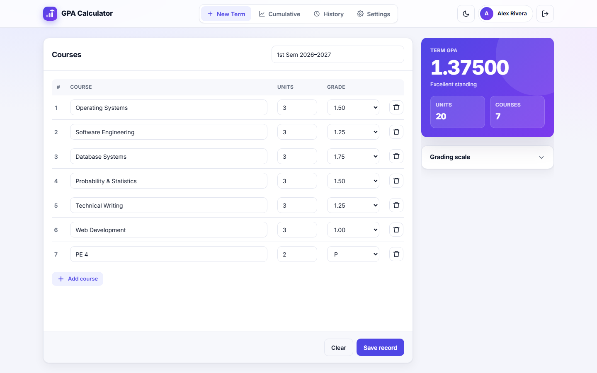
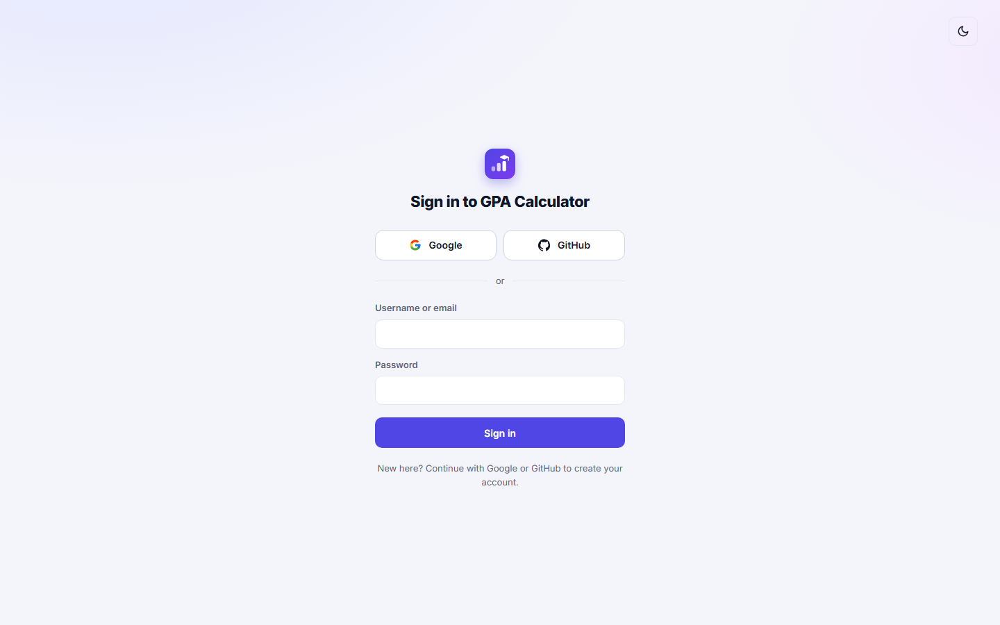
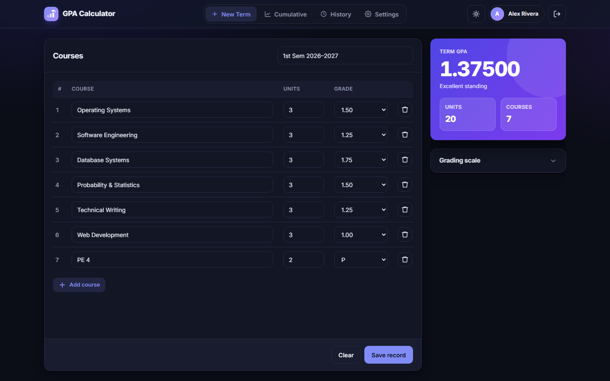
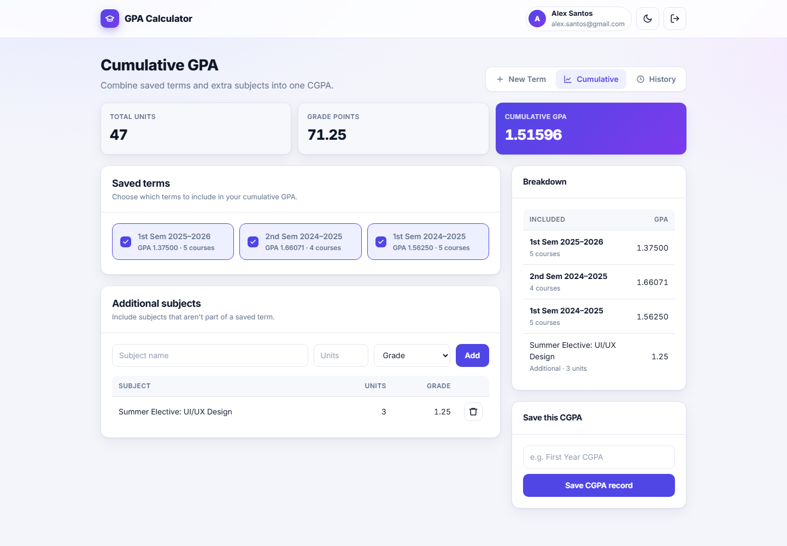
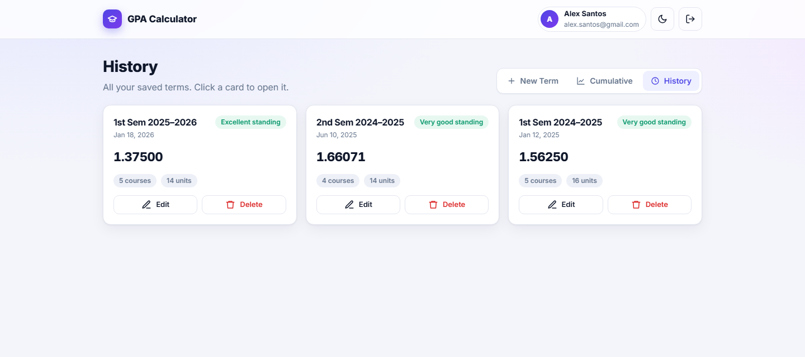
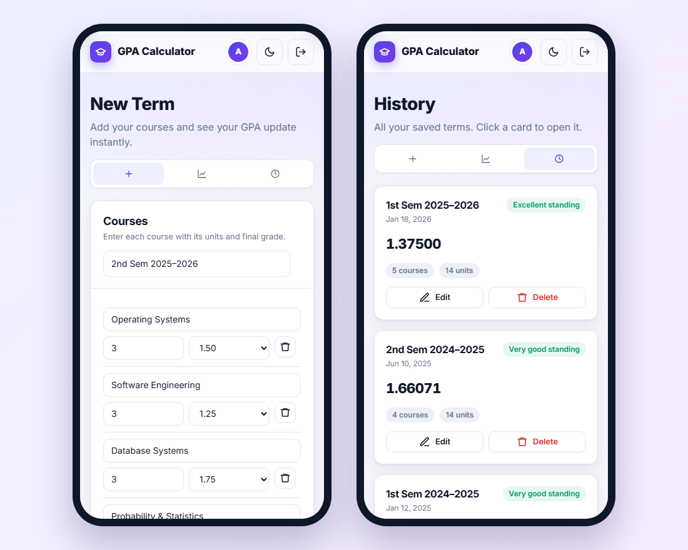

<div align="center">

# 🎓 GPA Calculator

**A modern web app for computing, saving, and tracking your term GPA and cumulative GPA.**

Sign in with Google or GitHub, enter your courses, and watch your GPA update as you type.




</div>

---

## Table of Contents

- [Features](#features)
- [Screenshots](#screenshots)
- [Tech Stack](#tech-stack)
- [Getting Started](#getting-started)
- [Configuration](#configuration)
- [Grading Scale](#grading-scale)
- [API Reference](#api-reference)
- [Project Structure](#project-structure)
- [Upgrading an Existing Database](#upgrading-an-existing-database)
- [Security Notes](#security-notes)

---

## Features

- **Google and GitHub sign-in for everyone.** School accounts (for example `@g.msuiit.edu.ph`), personal Google accounts (Gmail and others) and GitHub accounts can all sign in. Signing in with a different provider that has the same verified email opens the same account. Set `ALLOW_EXTERNAL_EMAILS=false` to restrict sign-in to school accounts only.
- **Live term GPA.** GPA, total units and course count update as you type.
- **Cumulative GPA (CGPA).** Combine any saved terms, add extra subjects that aren't part of a term, and save the result as a named CGPA record.
- **History.** Saved terms appear as cards showing GPA, an academic standing badge, course count and units. You can open, edit or delete any of them.
- **Light and dark themes.** The app follows your system theme by default and remembers your choice.
- **Responsive.** The layout adapts from desktop down to phone screens.
- **Precise.** GPA values are computed and stored to 5 decimal places.
- **Persistent sessions.** Sessions are stored in MySQL, so you stay signed in after the server restarts.

## Screenshots

| Sign in | Dark mode |
| :---: | :---: |
|  |  |

| Cumulative GPA | History |
| :---: | :---: |
|  |  |

<div align="center">

**Mobile**



</div>

## Tech Stack

| Layer | Technology |
| --- | --- |
| Backend | Node.js, Express |
| Database | MySQL 8 (`mysql2`) |
| Auth | Google OAuth 2.0 (`google-auth-library`), GitHub OAuth (built-in `fetch`), `express-session` |
| Sessions | `express-mysql-session` |
| Frontend | Vanilla HTML, CSS and JavaScript, with the Inter font |

## Getting Started

### Prerequisites

- [Node.js](https://nodejs.org/) 18 or newer
- [MySQL](https://dev.mysql.com/downloads/) 8 or newer
- A Google Cloud project with OAuth credentials
- A GitHub OAuth App

### 1. Create the database

Run the schema in the MySQL client (MySQL Workbench or the `mysql` CLI):

```sql
SOURCE db/schema.sql;
```

### 2. Create Google OAuth credentials

1. Open the [Google Cloud Console](https://console.cloud.google.com/), create a project, and go to **APIs & Services → OAuth consent screen**.
2. Choose **External** so that personal Google accounts can sign in. Then publish the app. The `openid email profile` scopes don't need verification.
   > Choose **Internal** only if the project belongs to your school's Google Workspace and you want school accounts only.
3. Go to **Credentials → Create credentials → OAuth client ID → Web application**.
4. Add the authorized redirect URI `http://localhost:3000/api/auth/google/callback`, plus your production URL when you deploy.
5. Copy the client ID and client secret into your `.env` file.

### 3. Create a GitHub OAuth App

1. Go to **GitHub → Settings → Developer settings → OAuth Apps → New OAuth App**.
2. Set the homepage URL to `http://localhost:3000` and add the redirect URI `http://localhost:3000/api/auth/github/callback`, plus your production URL when you deploy. Leave wildcard matching and device flow off.
3. Register the app, then generate a client secret.
4. Copy the client ID and client secret into your `.env` file.

### 4. Install and configure

```bash
copy .env.example .env
npm install
```

Fill in the values in `.env` (see [Configuration](#configuration)).

### 5. Run

```bash
npm run dev
```

Then open **http://localhost:3000**.

| Script | Description |
| --- | --- |
| `npm start` | Start the server |
| `npm run dev` | Start with auto-reload (nodemon) |
| `npm run db:setup` | Create the tables in the database configured in `.env` (local or online) |

## Configuration

All settings are read from `.env` locally, and from Project Settings → Environment Variables on Vercel. See **[DEPLOY.md](DEPLOY.md)** for deploying to Vercel with an online database and a custom domain.

| Variable | Required | Default | Description |
| --- | :---: | --- | --- |
| `APP_URL` | | `http://localhost:3000` | Public address of the site. The OAuth callback URLs are built from it. |
| `DATABASE_URL` | | | Single MySQL connection URL (hosted databases). Overrides the `DB_*` values. |
| `DB_SSL` | | `false` | `true` for hosted databases that require TLS (TiDB Cloud, Aiven) |
| `DB_SSL_CA` | | | CA certificate (PEM contents or a file path), if your provider gives one |
| `DB_HOST` | | `localhost` | MySQL host |
| `DB_PORT` | | `3306` | MySQL port |
| `DB_USER` | | `root` | MySQL user |
| `DB_PASSWORD` | | *(empty)* | MySQL password |
| `DB_NAME` | | `gpa_app` | Database name |
| `SESSION_SECRET` | ✅ | | Long random string used to sign session cookies |
| `PORT` | | `3000` | HTTP port |
| `GOOGLE_CLIENT_ID` | ✅ | | OAuth client ID |
| `GOOGLE_CLIENT_SECRET` | ✅ | | OAuth client secret |
| `GOOGLE_REDIRECT_URI` | | `<APP_URL>/api/auth/google/callback` | Override for the Google callback URL |
| `GITHUB_CLIENT_ID` | ✅ | | GitHub OAuth App client ID |
| `GITHUB_CLIENT_SECRET` | ✅ | | GitHub OAuth App client secret |
| `GITHUB_REDIRECT_URI` | | `<APP_URL>/api/auth/github/callback` | Override for the GitHub callback URL |
| `ALLOWED_EMAIL_DOMAINS` | | *(empty)* | Comma-separated school domains, e.g. `g.msuiit.edu.ph`. Shown on the login page. When external emails are disabled, only these domains can sign in. |
| `ALLOW_EXTERNAL_EMAILS` | | `true` | `true`: any verified Google or GitHub account can sign in. `false`: only `ALLOWED_EMAIL_DOMAINS` can sign in. |
| `NODE_ENV` | | | Set to `production` to enable secure cookies and trust the first proxy |

> If `ALLOWED_EMAIL_DOMAINS` is empty, external accounts are always allowed.

## Grading Scale

| Grade | Meaning | Counted in GPA |
| --- | --- | :---: |
| `1.00` | Excellent | ✅ |
| `1.25` – `1.50` | Very good | ✅ |
| `1.75` – `2.00` | Good | ✅ |
| `2.25` – `2.50` | Satisfactory | ✅ |
| `2.75` – `3.00` | Passing | ✅ |
| `5.00` | Failed | ✅ |
| `INC` | Incomplete | ❌ |
| `DROP` | Dropped | ❌ |

GPA is the unit-weighted average: **Σ(grade × units) / Σ units**. A lower GPA is better. `INC` and `DROP` are saved with the term but left out of the calculation.

## API Reference

Every `/api/gpa/*` endpoint requires an authenticated session.

| Method | Endpoint | Description |
| --- | --- | --- |
| `GET` | `/api/auth/google` | Start Google sign-in |
| `GET` | `/api/auth/google/callback` | Google OAuth callback |
| `GET` | `/api/auth/github` | Start GitHub sign-in |
| `GET` | `/api/auth/github/callback` | GitHub OAuth callback |
| `GET` | `/api/auth/config` | Sign-in policy (`allowedDomains`, `allowExternal`) |
| `GET` | `/api/auth/me` | Current user |
| `POST` | `/api/auth/logout` | Sign out |
| `GET` | `/api/gpa/history` | List saved terms |
| `POST` | `/api/gpa/save` | Save a term `{ termName, courses[] }` |
| `PUT` | `/api/gpa/:id` | Update a term |
| `DELETE` | `/api/gpa/:id` | Delete a term |
| `POST` | `/api/gpa/calculate-cumulative` | Compute CGPA `{ termIds[], additionalSubjects[] }` |
| `GET` | `/api/gpa/cgpa` | List saved CGPA records |
| `POST` | `/api/gpa/save-cgpa` | Save a CGPA record `{ recordName, termIds[], additionalSubjects[] }` (recomputed on the server) |
| `DELETE` | `/api/gpa/cgpa/:id` | Delete a CGPA record |
| `GET` | `/api/health` | Health check, including database connectivity |

Pages are served at clean URLs: `/login` and `/dashboard`. Old `.html` links (for example `/login.html`) get a `301` redirect to the clean URL, with the query string kept. Express does this locally and `cleanUrls` in `vercel.json` does it on Vercel.

Unknown `/api/*` routes return `404` with `{ "error": "Not found" }`. Any other unknown URL shows the branded 404 page (`public/404.html`) in a browser, or a plain `Not found` for non-browser clients.

## Project Structure

```
gpa-calculator/
├── db/
│   ├── db.js              # MySQL connection pool
│   └── schema.sql         # Database schema
├── docs/screenshots/      # README images
├── middleware/
│   └── auth.js            # Session guard for protected routes
├── public/
│   ├── login.html         # Sign-in page
│   ├── 404.html           # Not-found page
│   ├── dashboard.html     # Main app
│   ├── dashboard.js       # Dashboard logic
│   ├── darkmode.js        # Theme handling
│   └── style.css          # Design system and styles
├── routes/
│   ├── auth.js            # Google/GitHub OAuth and session routes
│   └── gpa.js             # GPA and CGPA routes
├── server.js              # Express app entry point
└── .env.example           # Environment template
```

## Upgrading an Existing Database

**5-decimal precision:**

```sql
ALTER TABLE gpa_records MODIFY COLUMN gpa DECIMAL(6,5) NOT NULL;
ALTER TABLE cgpa_records MODIFY COLUMN cgpa DECIMAL(6,5) NOT NULL;
```

**Google sign-in:**

```sql
ALTER TABLE users ADD COLUMN google_sub VARCHAR(64) NULL UNIQUE AFTER email;
ALTER TABLE users MODIFY COLUMN password_hash VARCHAR(191) NULL;
```

If an existing user signs in with a Google account that uses the same email, the two are linked automatically on first sign-in and the user keeps their GPA history.

**GitHub sign-in:**

```sql
ALTER TABLE users ADD COLUMN github_id BIGINT UNSIGNED NULL UNIQUE AFTER google_sub;
```

Existing accounts are linked the same way, through the GitHub account's primary verified email.

## Security Notes

- Only Google accounts with a **verified email** can sign in. When external emails are disabled, the school domain is checked on the server (the `hd` claim plus the email suffix), not just through the Google URL hint.
- GitHub sign-in only uses the account's **primary verified email**, which is read through the `user:email` scope even if it's private. The GitHub access token is used once to read the profile and is never stored.
- The OAuth `state` parameter protects the sign-in flow against CSRF, and the session ID is regenerated after login.
- Session cookies are `httpOnly` and `sameSite=lax`, and they are `secure` in production.
- User-entered text is HTML-escaped before it is rendered.
- A strict Content-Security-Policy (no inline scripts) plus `nosniff`, `X-Frame-Options`, HSTS and Referrer-Policy headers are sent by both Express and `vercel.json`.
- State-changing API requests from another origin are rejected, request bodies are capped at 100 KB, and course names, units and grades are validated on the server.
- CGPA records are recomputed on the server from the user's own terms, so a client cannot save an arbitrary value.
- Only `public/` is served as static files. `.env`, source files, `.git` and `node_modules` all return `404`, including path-traversal attempts such as `/%2e%2e/.env`. `.vercelignore` also keeps `.env` out of Vercel uploads.
- Never commit `.env` or downloaded `client_secret_*.json` files.
