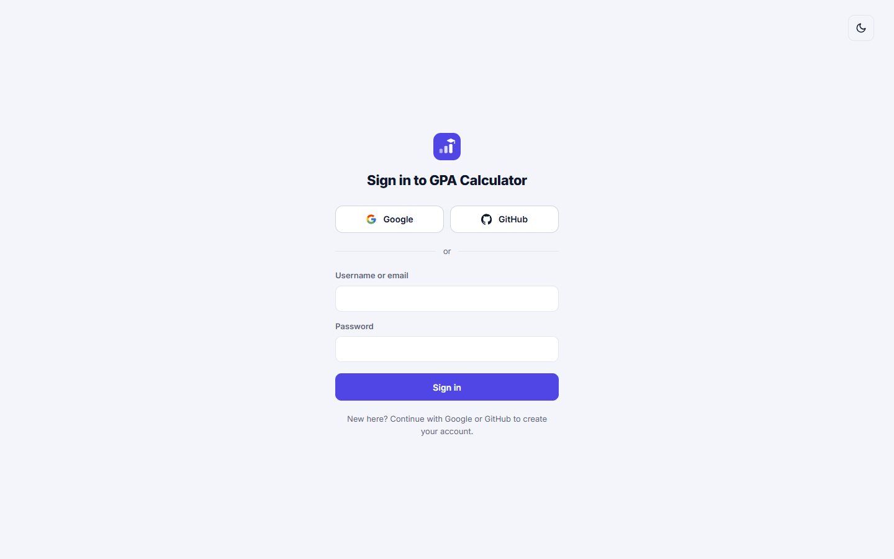
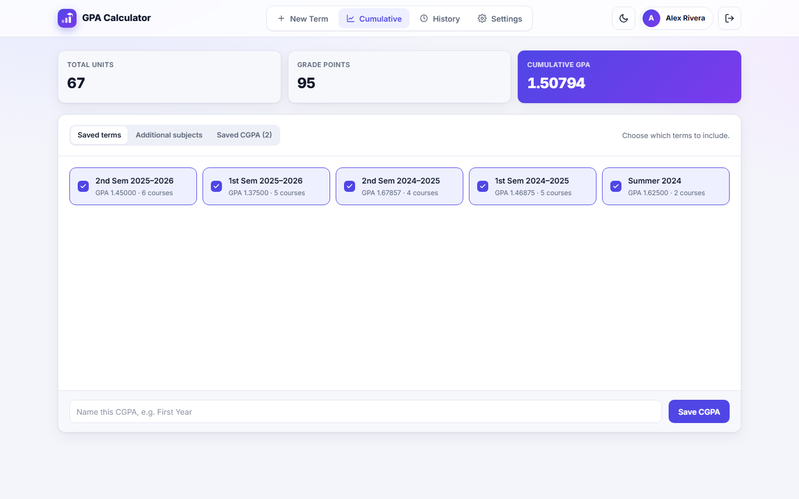
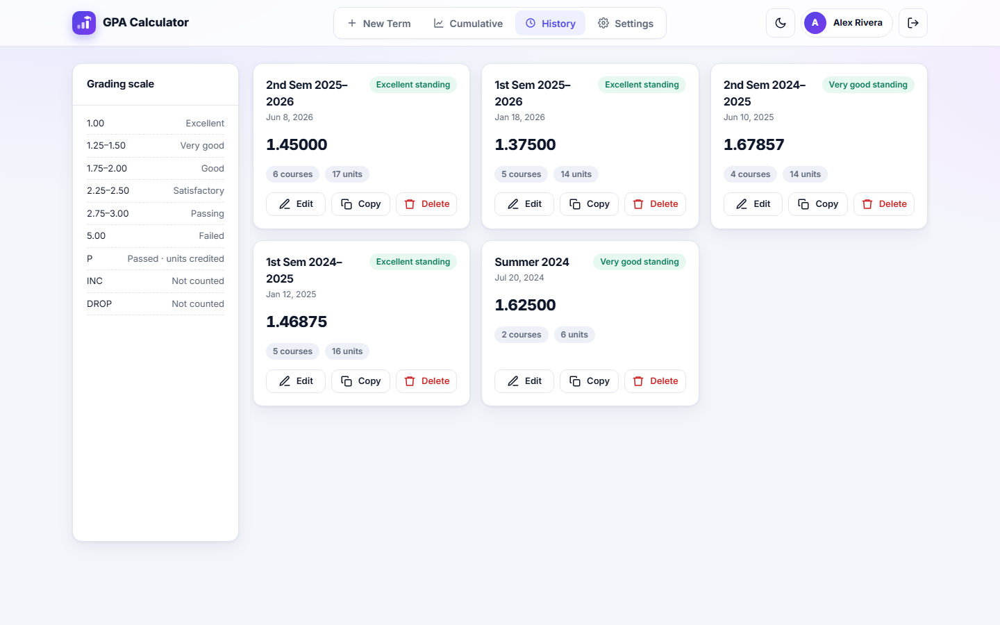
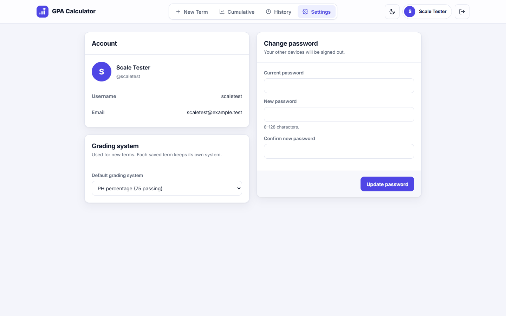
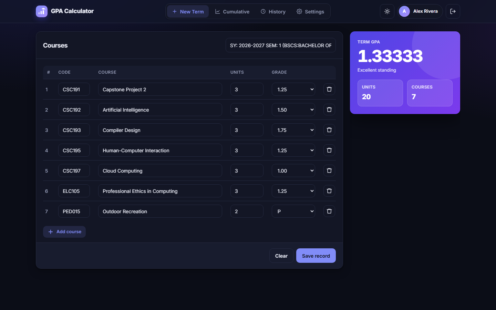
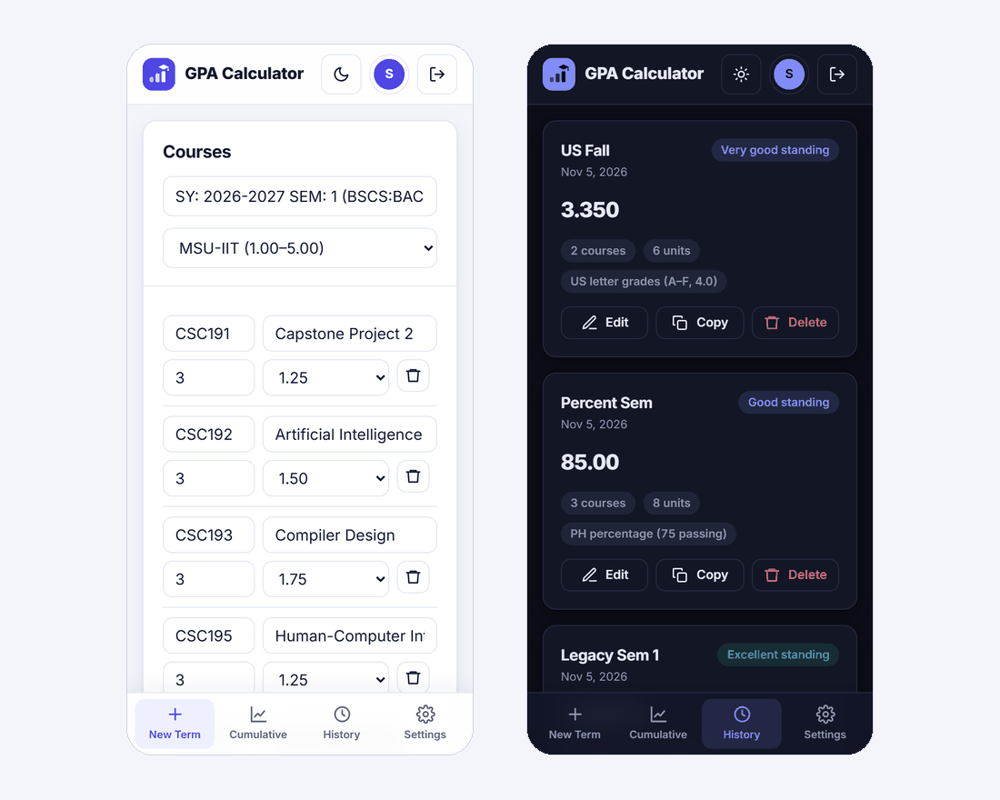

<div align="center" id="top">


# GPA Calculator

**Compute, save and track your term GPA and cumulative GPA, on the MSU-IIT scale or another grading system.**


[](https://github.com/Jevoel16/gpa-calculator/actions/workflows/ci.yml)


</div>

---

## Table of Contents

- [About](#about)
- [Screenshots](#screenshots)
- [Features](#features)
- [Tech Stack](#tech-stack)
- [Getting Started](#getting-started)
- [Configuration](#configuration)
- [Usage](#usage)
- [More](#more)
- [Contributing](#contributing)
- [License](#license)
- [Author](#author)

---

## About

GPA Calculator lets students enter their grades each term, see their GPA update as they type, and keep every term and cumulative GPA saved in one place. It was built for MSU-IIT students, whose 1.00–5.00 scale most online calculators get wrong, and also supports other Philippine and US grading systems. Try it live at [gpa-calculator.jevoelorbilla.dev](https://gpa-calculator.jevoelorbilla.dev).

<p align="right"><a href="#top">back to top ↑</a></p>

---

## Screenshots

<details>
<summary><b>Screenshots</b></summary>

<table>
<tr>
<td width="50%" align="center"><b>Sign in</b><br><a href="docs/images/login.png"></a></td>
<td width="50%" align="center"><b>New Term</b><br><a href="docs/images/new-term.png"></a></td>
</tr>
<tr>
<td width="50%" align="center"><b>Cumulative GPA</b><br><a href="docs/images/cumulative.png"></a></td>
<td width="50%" align="center"><b>History</b><br><a href="docs/images/history.png"></a></td>
</tr>
<tr>
<td width="50%" align="center"><b>Settings</b><br><a href="docs/images/settings.png"></a></td>
<td width="50%" align="center"><b>Dark mode</b><br><a href="docs/images/new-term-dark.png"></a></td>
</tr>
<tr>
<td width="50%" align="center"><b>Phone (bottom tab bar)</b><br><a href="docs/images/mobile.png"></a></td>
<td width="50%"></td>
</tr>
</table>

</details>

<p align="right"><a href="#top">back to top ↑</a></p>

---

## Features

- Sign in with Google, GitHub, or a username and password.
- Live term GPA, units and course count as you type.
- Paste a semester straight from MyIIT to fill in the term and courses.
- Cumulative GPA from any saved terms plus extra subjects, saved as named records.
- Five grading systems, with a default per account and a choice per term ([details](docs/grading-systems.md)).
- History of saved terms with academic standing, edit, copy and delete.
- Works on phones, in light and dark themes, and installs to your home screen.
- Accessible: keyboard friendly and checked against WCAG 2.2 AA.

<p align="right"><a href="#top">back to top ↑</a></p>

---

## Tech Stack

| Layer | Tools |
| --- | --- |
| Backend | Node.js 22.14.0, Express 5.3.0, express-session 1.19.0, dotenv 18.0.9 |
| Database | MySQL 8 or TiDB Cloud via mysql2 3.24.6, sessions in express-mysql-session 3.0.3 |
| Auth | google-auth-library 11.3.3, GitHub OAuth, scrypt passwords |
| Frontend | Vanilla HTML, CSS and JavaScript, self-hosted Inter font |
| Hosting | Vercel with Web Analytics ([DEPLOY.md](DEPLOY.md)) |

<p align="right"><a href="#top">back to top ↑</a></p>

---

## Getting Started

Needs Node.js 22 (see `.nvmrc`), a MySQL 8 database, and Google and GitHub OAuth apps ([setup guide](docs/setup.md)).

```bash
npm install
copy .env.example .env
npm run db:setup
npm run dev
```

Keep only the Local block in `.env` and fill it in before `db:setup`, then open **http://localhost:3000**.

<p align="right"><a href="#top">back to top ↑</a></p>

---

## Configuration

Settings come from `.env` (see [`.env.example`](.env.example)), or from **Project Settings → Environment Variables** on Vercel.

<details>
<summary><b>Environment variables</b></summary>

| Variable | Required | Default | Description |
| --- | :---: | --- | --- |
| `APP_URL` | | `http://localhost:3000` | Public address of the site. OAuth callbacks, `robots.txt` and `sitemap.xml` are built from it. |
| `DATABASE_URL` | | | Single MySQL connection URL (hosted databases). Overrides the `DB_*` values. |
| `DB_SSL` | | `false` | `true` for hosted databases that require TLS (TiDB Cloud, Aiven) |
| `DB_SSL_CA` | | | CA certificate (PEM contents or a file path), if your provider gives one |
| `DB_HOST` | | `localhost` | MySQL host |
| `DB_PORT` | | `3306` | MySQL port |
| `DB_USER` | | `root` | MySQL user |
| `DB_PASSWORD` | | *(empty)* | MySQL password |
| `DB_NAME` | | `gpa_app` | Database name |
| `SESSION_SECRET` | ✅ | | Long random string used to sign session cookies |
| `PORT` | | `3000` | HTTP port |
| `GOOGLE_CLIENT_ID` | ✅ | | OAuth client ID |
| `GOOGLE_CLIENT_SECRET` | ✅ | | OAuth client secret |
| `GOOGLE_REDIRECT_URI` | | `<APP_URL>/api/auth/google/callback` | Override for the Google callback URL |
| `GITHUB_CLIENT_ID` | ✅ | | GitHub OAuth App client ID |
| `GITHUB_CLIENT_SECRET` | ✅ | | GitHub OAuth App client secret |
| `GITHUB_REDIRECT_URI` | | `<APP_URL>/api/auth/github/callback` | Override for the GitHub callback URL |
| `ALLOWED_EMAIL_DOMAINS` | | *(empty)* | Comma-separated school domains, e.g. `g.msuiit.edu.ph`. Enforced when external emails are off. |
| `ALLOW_EXTERNAL_EMAILS` | | `true` | `false` allows only `ALLOWED_EMAIL_DOMAINS` (always allowed when that list is empty) |
| `NODE_ENV` | | | `production` enables secure cookies and trusts the first proxy |

</details>

<p align="right"><a href="#top">back to top ↑</a></p>

---

## Usage

1. Sign in with Google or GitHub. The first time, choose a username and password.
2. On **New Term**, type a term name and add courses with units and grades, or paste a semester copied from MyIIT and fill in the highlighted units. Click **Save record**.
3. On **Cumulative**, tick the saved terms to include, add extra subjects if needed, then name and save the CGPA.
4. On **History**, edit, copy or delete saved terms beside the grading scale. **Settings** holds your default grading system and password.

The API is described in [docs/api.md](docs/api.md), and importing terms from an old database dump in [docs/setup.md](docs/setup.md#importing-terms-from-an-old-database-dump).

<p align="right"><a href="#top">back to top ↑</a></p>

---

## More

<details>
<summary><b>Project structure</b></summary>

```
db/           Connection pool and schema
docs/         Guides and README screenshots
lib/          Grading-scale lookup, APP_URL, password hashing, rate limiting
middleware/   Session guard
public/       Pages, styles, client scripts, icons and fonts
routes/       Auth and GPA API routes
scripts/      Database setup and import
test/         Automated tests (no database needed)
server.js     Express app and security headers
```

The full tree, tests and manual checks are in [docs/development.md](docs/development.md). Security and SEO notes are in [docs/security.md](docs/security.md) and [docs/seo.md](docs/seo.md).

</details>

<details>
<summary><b>Scripts</b></summary>

| Script | Description |
| --- | --- |
| `npm start` | Start the server |
| `npm run dev` | Start with auto-reload and `.env` |
| `npm test` | Run the automated tests |
| `npm run db:setup` | Create or upgrade the tables |
| `npm run db:import` | Import terms from an old `mysqldump` |

</details>

<p align="right"><a href="#top">back to top ↑</a></p>

---

## Contributing

Branch from `main` as `feat/…` or `fix/…`. Use [Conventional Commits](https://www.conventionalcommits.org/) (including `ci:`) and end the subject with the bumped version, e.g. `feat: add CSV export (v1.4.0)`; see [docs/development.md](docs/development.md#commits). Update this README with every change.

<p align="right"><a href="#top">back to top ↑</a></p>

---

## License

Sprucetrap Source-Available License 1.0. See [LICENSE](LICENSE).

<p align="right"><a href="#top">back to top ↑</a></p>

---

## Author

**Sprucetrap** ([github.com/Jevoel16](https://github.com/Jevoel16)), built for MSU-IIT students.

<p align="right"><a href="#top">back to top ↑</a></p>
